# Dispatch Data Analysis with Microsoft SQL Server

A reproducible SQL Server portfolio project based on **Dispatch Data Analysis Using Microsoft SQL Server** by Dumoteyim Abiye-Suku. It documents a CSV-to-database workflow, dimensional modeling, and practical queries for product, customer, date, and location analysis.

> The original article describes the project process and query examples, but does not publish the source CSV or numeric result tables. This repository therefore does not claim specific sales totals, rankings, or observed trends. Queries here are designed to reproduce and extend the analysis when run against the source data.

**Original report:** [Dispatch Data Analysis Using Microsoft SQL Server on Medium](https://medium.com/@dumoaby/dispatch-data-analysis-using-microsoft-sql-server-1ba099b320e1)  
**Author:** Dumoteyim Abiye-Suku  
**Platform:** Microsoft SQL Server / SQL Server Management Studio (SSMS)

## Project goals

The project uses SQL to:

- Create a database and import a dispatch/sales CSV.
- Inspect transaction records and filter by product, sales amount, quantity, or state.
- Create product, customer, calendar-date, and location dimensions from the transaction table.
- Join transaction facts to descriptive attributes and prepare for grouped performance analysis.
- Identify data-modeling issues that should be addressed before treating the tables as a production star schema.

## Repository layout

```text
sql/
  01_create_database.sql      Create the project database
  02_create_dimensions.sql    Build distinct analytical dimensions
  03_analysis_queries.sql     Exploration, joins, aggregations, and QA checks
docs/
  data-dictionary.md          Expected source columns and modeling notes
images/
  01-...png                   Original screenshots from the Medium report
  ...
```

## Getting started

### Requirements

- SQL Server 2017 or newer is recommended. The examples use standard T-SQL features available in contemporary SQL Server versions.
- SSMS or another SQL Server client.
- The project CSV used in the article. It is not redistributed in this repository; obtain it from the project owner/source and confirm you have permission to use it.

### Load the source data

1. Run [`sql/01_create_database.sql`](sql/01_create_database.sql), or create `DispatchDB` in SSMS.
2. In SSMS, right-click the database and choose **Tasks → Import Flat File**. Select the source CSV, review inferred data types, and load the data as `dbo.Dispatch`.
3. Confirm the imported columns match the [data dictionary](docs/data-dictionary.md). SQL Server's CSV type inference may need manual correction, especially for dates and money values.
4. Run [`sql/02_create_dimensions.sql`](sql/02_create_dimensions.sql) in `DispatchDB`.
5. Run the queries in [`sql/03_analysis_queries.sql`](sql/03_analysis_queries.sql), replacing thresholds if your analysis requires different cutoffs.

The scripts use `DROP TABLE IF EXISTS` to allow repeatable development runs. Do not run them in a database containing tables you need to preserve without reviewing the statements first.

## Data model

The intended analytical shape has `dbo.Dispatch` as the transaction/fact source and four lookup dimensions:

- `dbo.DimProduct` — one row per product identifier and name.
- `dbo.DimCustomer` — one row per customer identifier and name.
- `dbo.DimDate` — one row per order date, with calendar attributes.
- `dbo.DimLocation` — one row per city/state pair.

The source article creates these dimensions using `SELECT INTO`. The repository scripts use explicit `CREATE TABLE` statements for clarity and add `DISTINCT` to the customer dimension so that repeated transactions do not become duplicate customer rows. They do not add foreign keys: the article does not provide data-quality validation or a declared key design, and relationships should only be enforced after checking source uniqueness and null behavior.

A location join must use **both `City` and `State`**. Joining only on city can match a city-name collision across states and inflate transaction rows. Likewise, the article's `TOP 5` query has no `ORDER BY`, so SQL Server is free to return any five rows; the reproducible version orders the names first.

## Analysis included

`03_analysis_queries.sql` contains runnable examples for:

- Basic record inspection and row counts.
- Product ID, high-sales, and quantity filters.
- Lagos location and transaction filters.
- Customer and product ordering, including a deterministic top-five example.
- Dispatch-level product details and Laptop Stand transaction records.
- Location-enriched dispatch records using the composite city/state match.
- Sales and quantity summaries by product, customer, state, and order month.
- Basic data-quality checks for null identifiers, duplicate dimension candidates, and unmatched fact keys.

Grouped queries return results only when executed against an imported dataset. They are not presented as pre-computed findings.

## Report screenshots

The images below are the original screenshots embedded in the linked Medium report. They are included here for faithful project context and credited to the report author. A repeated Location Dimension screenshot in the article is included once.

### Import and exploration

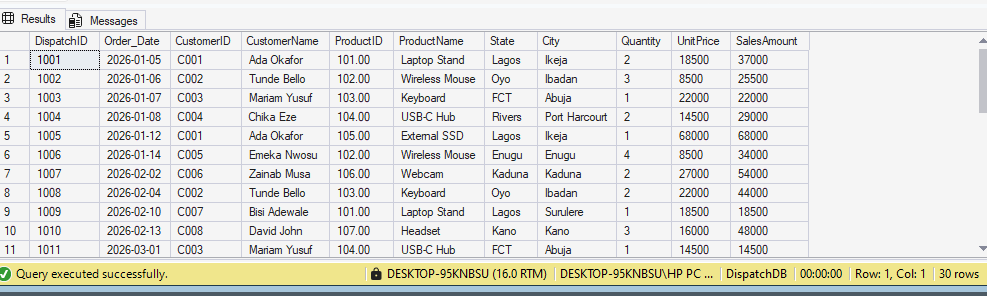

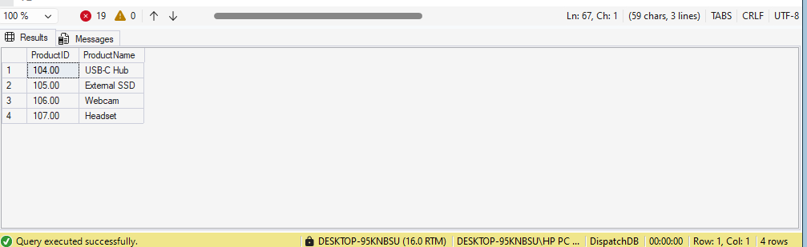

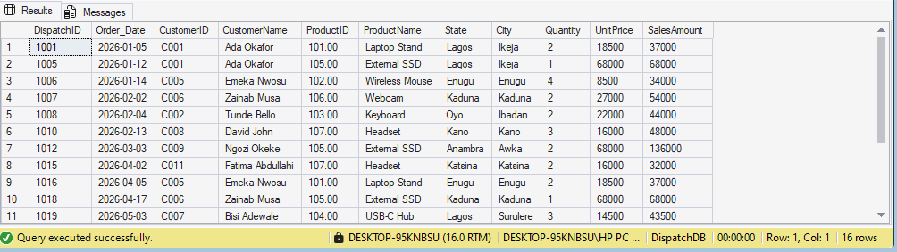

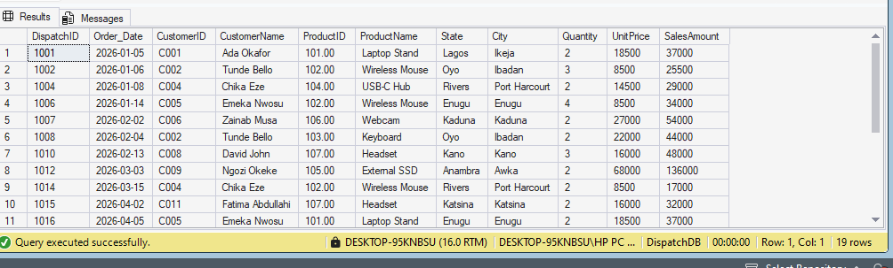

### Dimensions and relationships

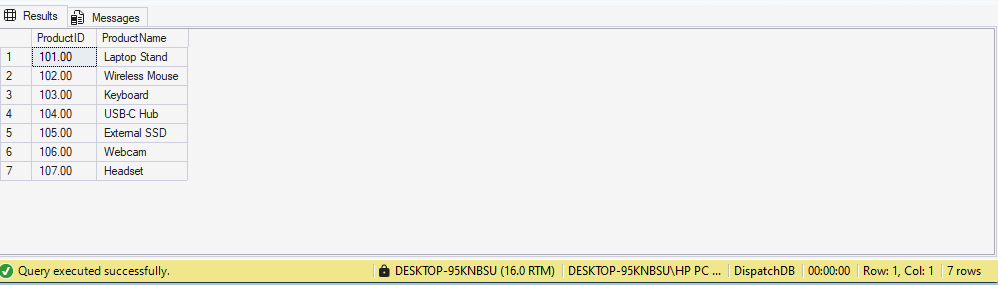

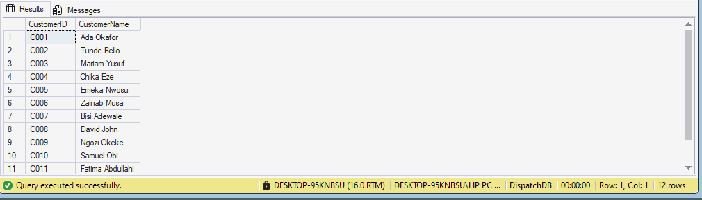

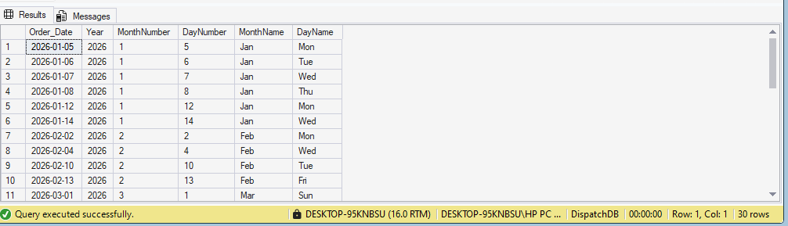

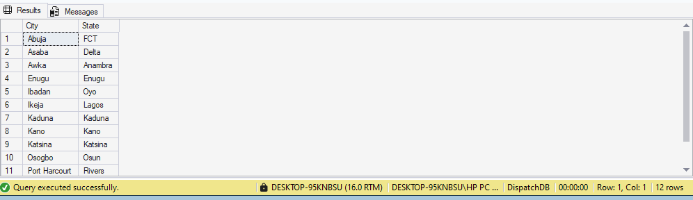

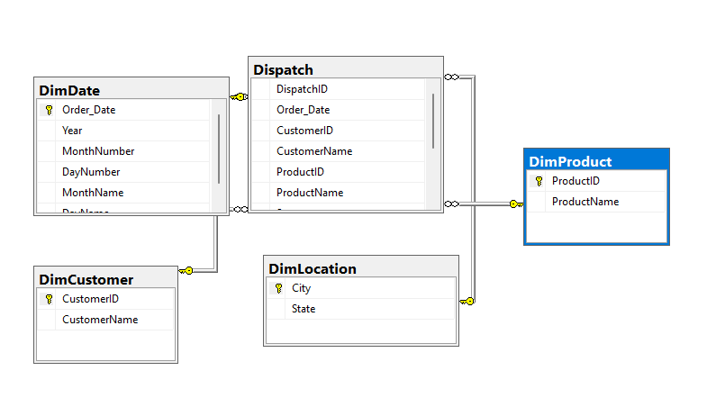

### Geographic, customer, and product exploration

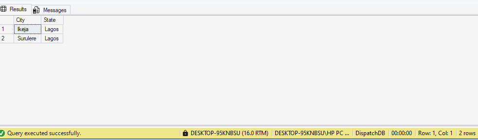

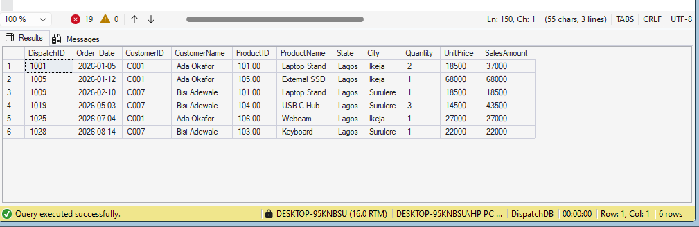

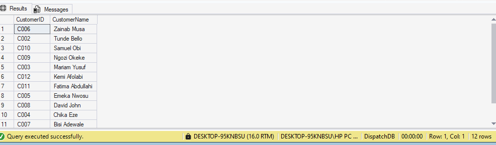

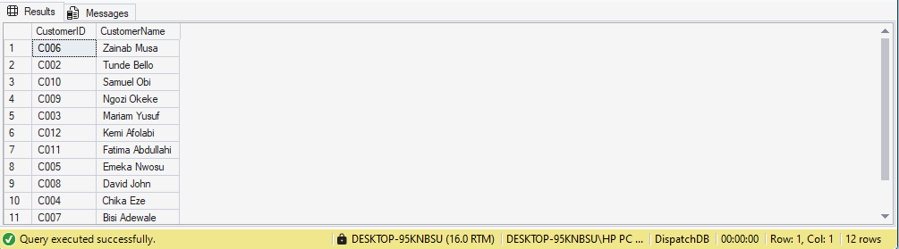

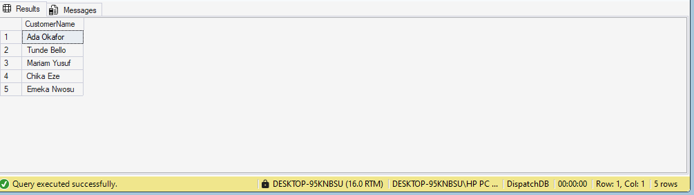

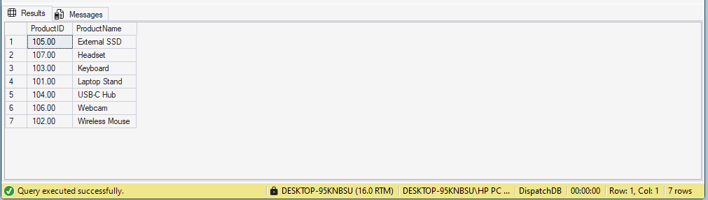

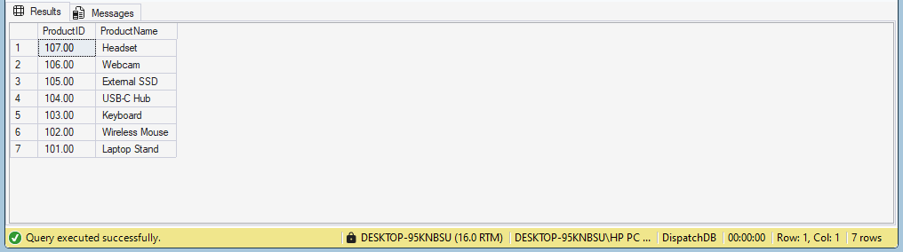

### Joined analysis

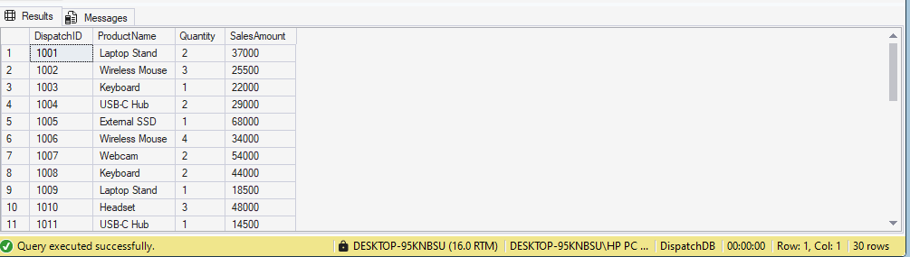

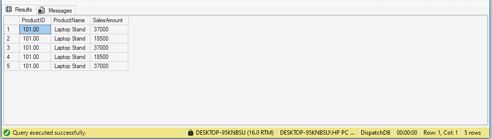

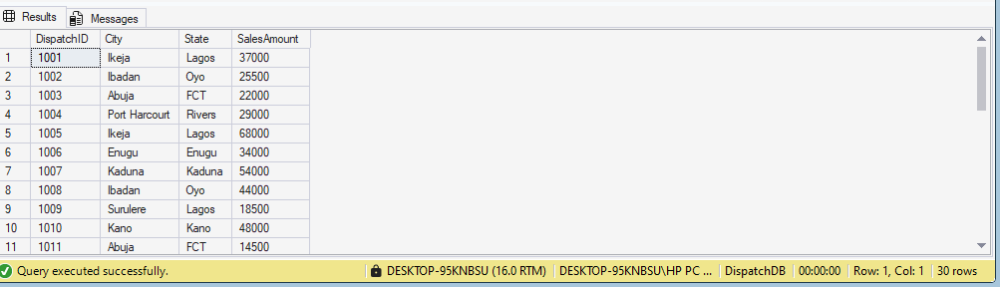

## Limitations and next steps

This is an educational SQL analysis, not a validated production warehouse. The CSV and exact source schema are not included, so data types and column names must be confirmed during import. The article describes intended links to the four dimensions but does not supply a complete set of enforced database relationships. The SQL scripts deliberately make assumptions visible and include checks to help validate those assumptions.

Useful next steps include defining surrogate keys and foreign-key constraints after validation, comparing monthly and yearly sales, ranking products and customers by sales and quantity, checking whether revenue measures are net or gross, and connecting the curated model to a Power BI report. Profitability or discount analysis should only be added if the dataset contains suitable fields.

## Image and content attribution

Project narrative and screenshots are from Dumoteyim Abiye-Suku's [original Medium article](https://medium.com/@dumoaby/dispatch-data-analysis-using-microsoft-sql-server-1ba099b320e1). Screenshots are reproduced here as project materials from that article. The SQL scripts and explanatory documentation in this repository are organized and extended for reproducibility. No dataset license or separate image license was supplied with the article; consult the author/source before reusing the screenshots or obtaining/redistributing the underlying data outside this project context.

## References

- Dumoteyim Abiye-Suku, [Dispatch Data Analysis Using Microsoft SQL Server](https://medium.com/@dumoaby/dispatch-data-analysis-using-microsoft-sql-server-1ba099b320e1).
- Microsoft Learn, [SELECT (Transact-SQL)](https://learn.microsoft.com/en-us/sql/t-sql/queries/select-transact-sql).
- Microsoft Learn, [Joins (SQL Server)](https://learn.microsoft.com/en-us/sql/relational-databases/performance/joins).
